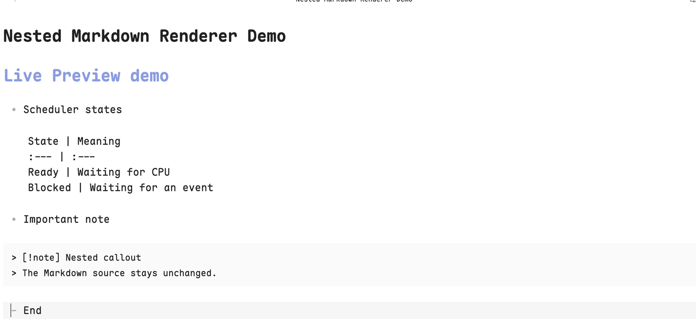
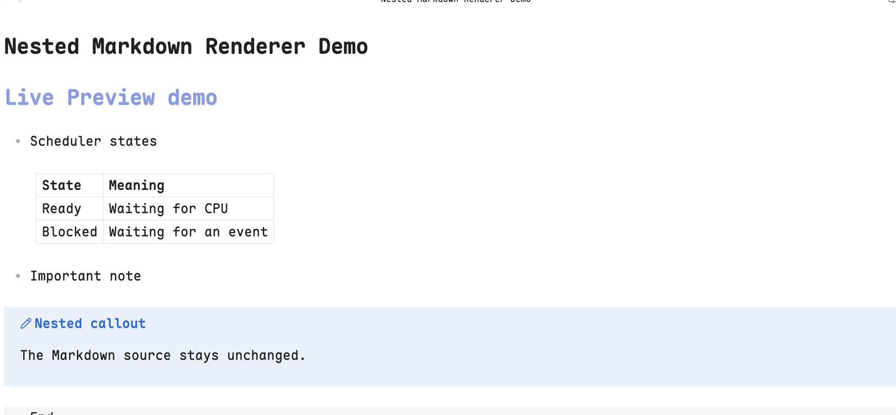

# Nested Markdown Renderer

[](https://github.com/JoeChen2me/obsidian-nested-markdown-renderer/actions/workflows/ci.yml)
[](https://github.com/JoeChen2me/obsidian-nested-markdown-renderer/releases)
[](LICENSE)

Render nested Markdown tables and indented callouts correctly in Obsidian Live Preview without changing note source.

## Why

Obsidian Reading view can render GFM tables nested inside list items, but Live Preview may leave the same table as pipe-delimited source text. Indented callouts can similarly degrade into code blocks. Nested Markdown Renderer closes those two gaps while preserving immediate source editing.





## Features

- Renders nested GFM tables as semantic HTML `<table>` elements.
- Supports optional leading and trailing pipes, escaped pipes, alignment markers, and single-column tables.
- Preserves inline Markdown, links, and integrations that process rendered tables.
- Repairs indented callouts that appear as code blocks in Live Preview.
- Keeps folded callouts folded.
- Reveals the original Markdown when the cursor enters a table or the rendered table is clicked.
- Never rewrites note content.
- Works entirely offline and makes no network requests.

## Supported syntax

```markdown
- Comparison

	Feature | Live Preview | Reading view
	:--- | :---: | ---:
	Semantic table | Yes | Yes
```

Leading and trailing pipes remain optional, as defined by GFM. The table must be nested under a list item and its header and delimiter rows must have matching column counts.

Indented callouts use normal Obsidian syntax:

```markdown
- Important detail

	> [!note]- Collapsed note
	> Callout content.
```

## Installation

### BRAT beta

1. Install the [BRAT](https://obsidian.md/plugins?id=obsidian42-brat) plugin.
2. Run **BRAT: Add a beta plugin for testing**.
3. Enter `JoeChen2me/obsidian-nested-markdown-renderer`.
4. Enable **Nested Markdown Renderer** under **Settings → Community plugins**.

### Manual installation

1. Download `main.js`, `manifest.json`, and `styles.css` from the latest GitHub release.
2. Place them in `<vault>/.obsidian/plugins/nested-markdown-renderer/`.
3. Reload Obsidian and enable **Nested Markdown Renderer**.

Community directory installation will be added after the initial review.

## Compatibility

- Obsidian 1.12.7 or later.
- Desktop only in the initial release.
- Tested on macOS with Live Preview.

Reading view already renders these blocks correctly and is left untouched.

## Limitations

- The plugin only handles tables nested beneath list items. Top-level tables remain under Obsidian's native renderer.
- Callout repair relies on Obsidian's current Live Preview DOM structure because no public preprocessing hook exists for this case.
- Mobile support is intentionally disabled until dedicated mobile testing is complete.

## Similar plugins

[Indented Table](https://github.com/nnyj/obsidian-indented-table) improves the readability of pipe-delimited source with editor decorations. Nested Markdown Renderer instead renders a semantic table and also repairs nested callouts. The implementations are independent.

## Privacy and security

Nested Markdown Renderer:

- does not collect telemetry;
- does not read or write files through Obsidian's Vault or Adapter APIs;
- does not persist or transmit note content;
- does not access the network;
- does not execute remote code.

It only inspects the active CodeMirror document and rendered editor DOM.

## Development

```bash
npm install
npm run check
npm run dev
```

`npm run dev` watches TypeScript sources and writes `main.js` at the repository root. Copy `main.js`, `manifest.json`, and `styles.css` into the plugin folder in a test vault, then reload the plugin.

## License

[MIT](LICENSE)
